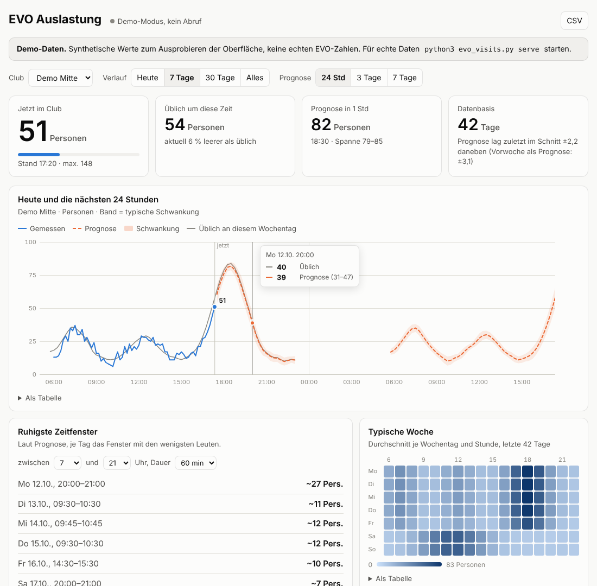

# EVO Visits Tracker

Schreibt die Live-Besucherzahlen von [visits.evofitness.de](https://visits.evofitness.de/) pro Club regelmäßig mit, zeigt den Verlauf und prognostiziert, wie voll es in den nächsten Stunden und Tagen wird. Läuft komplett lokal, braucht nur Python 3.9+ ohne weitere Pakete. Playwright ist optional, falls die Seite ihre Zahlen erst per JavaScript nachlädt.



## Schnellstart

```bash
cd projects/evo-visits
python3 evo_visits.py probe     # einmal schauen, ob die Erkennung die Clubs findet
python3 evo_visits.py serve     # Sammler + Dashboard starten
open http://127.0.0.1:8765
```

`serve` fragt alle 10 Minuten zwischen 05:30 und 23:30 Uhr ab, speichert in `data/visits.db` (SQLite) und liefert das Dashboard aus. Der Button „Jetzt abrufen“ löst sofort einen Abruf aus, „CSV“ exportiert alle Rohdaten.

Wer vorher sehen will, wie das mit ein paar Wochen Daten aussieht: `python3 evo_visits.py demo` startet das Dashboard mit synthetischen Werten in einer separaten Datenbank (`data/demo.db`), klar als Demo markiert.

## Erster Lauf: Erkennung prüfen

Die EVO-Seite hat keine dokumentierte API. Der Sammler sucht deshalb selbst nach der Datenquelle, in dieser Reihenfolge: JSON direkt im HTML (Next.js, Inertia, State-Objekte), API-URLs in HTML und JavaScript-Bundles, eine Text-Heuristik auf dem HTML („Clubname … 42 Personen“, „23 / 150“, „35 %“) und zuletzt ein Headless-Browser, der alle JSON-Antworten mitschneidet und bei Bedarf ein Club-Dropdown durchklickt. Die gefundene API-URL wird in `data/source.json` gemerkt, danach ist jeder Abruf ein einziger Request.

`python3 evo_visits.py probe` zeigt, was dabei herauskommt, und legt alle Rohdaten unter `data/probe/<zeitstempel>/` ab (HTML, gefundene URLs, JSON-Antworten, `summary.txt`).

Findet `probe` nichts, liegt es fast immer daran, dass die Seite per JavaScript lädt. Dann den Browser-Modus aktivieren:

```bash
pip3 install playwright
python3 -m playwright install chromium
python3 evo_visits.py probe
```

Erkennt die Heuristik die falschen Felder, lässt sich die Quelle in `config.json` fest verdrahten (Vorlage: `config.example.json`). Die Werte für `json_url`, `list_path` und die Feldnamen stehen in der `summary.txt` vom Probe-Lauf:

```json
{
  "source": {
    "json_url": "https://visits.evofitness.de/api/...",
    "list_path": "data",
    "name_key": "name",
    "count_key": "current",
    "capacity_key": "max"
  }
}
```

## Dauerbetrieb auf dem Mac

Damit die Historie lückenlos wird, sollte der Sammler dauerhaft laufen. Als LaunchAgent startet er beim Login automatisch und nach einem Absturz neu:

```bash
python3 evo_visits.py launchd > ~/Library/LaunchAgents/local.evo-visits.plist
launchctl load ~/Library/LaunchAgents/local.evo-visits.plist
# stoppen: launchctl unload ~/Library/LaunchAgents/local.evo-visits.plist
```

Logs landen in `data/server.log`. Schläft der Laptop, entstehen Lücken. Das Modell kommt damit klar, es fehlen dann einfach Messpunkte. Für eine wirklich durchgehende Reihe ist ein Raspberry Pi oder NAS der bessere Ort. Alternativ nur sammeln per cron und das Dashboard bei Bedarf starten:

```bash
*/10 6-23 * * * cd /pfad/zu/projects/evo-visits && /usr/bin/python3 evo_visits.py collect >> data/collect.log 2>&1
python3 evo_visits.py serve --no-collect
```

## Wie die Prognose funktioniert

Bewusst simpel und nachvollziehbar statt Blackbox. Die Messwerte werden in 15-Minuten-Slots gemittelt. Für jeden Wochentag und Slot entsteht daraus ein typischer Wert, wobei jüngere Wochen mehr zählen (Halbwertszeit 21 Tage) und Nachbar-Slots halb einfließen, um Rauschen zu glätten. Gibt es für einen Wochentag noch wenig Daten, wird zum Profil aller Werktage bzw. Wochenendtage hin geschrumpft, damit die Prognose schon nach wenigen Tagen etwas taugt.

Dazu kommt eine Tageskorrektur: Ist der Club gerade voller oder leerer als üblich, wird diese Abweichung in die nächsten Stunden fortgeschrieben und klingt mit einer Zeitkonstante von zwei Stunden ab. Das Band im Chart ist die typische Schwankung im jeweiligen Slot.

Das Dashboard zeigt zusätzlich, wie gut das funktioniert: Der Backtest sagt die letzten sieben Tage mit dem jeweils vorher bekannten Wissen vorher und vergleicht den mittleren Fehler mit dem naiven Ansatz „gleiche Uhrzeit letzte Woche“. Feiertage und Ferien kennt das Modell nicht, die verschwinden aber durch die Gewichtung nach ein paar Wochen wieder aus dem Profil.

## Konfiguration

Alle Optionen mit Defaults stehen in `evo/config.py`. Die wichtigsten für `config.json`: `interval_minutes` (10), `active_hours` („05:30-23:30“), `port` (8765), `mode` („auto“, „static“ oder „browser“), `history_weeks` (10), `half_life_days` (21) und `source` für die feste Quelle. Kommandozeile überschreibt die Datei: `--interval 5`, `--port 9000`, `--mode browser`.

## Aufbau

`evo/fetch.py` und `evo/extract.py` holen und erkennen die Zahlen, `evo/store.py` ist die SQLite-Ablage, `evo/forecast.py` das Modell, `evo/server.py` Webserver plus Hintergrund-Sammler, `web/index.html` das Dashboard (eigene SVG-Charts, keine externen Abhängigkeiten, Hell- und Dunkelmodus).

Tests laufen mit `python3 -m unittest discover -s tests -t .`. Sie decken diverse plausible Seitenformate ab (flache und verschachtelte JSON-Listen, Prozentwerte, eingebettetes JSON, HTML-Karten) sowie Ende-zu-Ende den API-Fund, eine JavaScript-gerenderte Seite und das Durchklicken eines Dropdowns. Die Browser-Tests laufen nur mit installiertem Playwright.

## Fair Use

Ein Abruf alle 10 Minuten ist weniger Last als ein einzelner Mensch, der die Seite offen hat. Das Tool ist für den privaten Gebrauch gedacht. Bitte das Intervall nicht in den Sekundenbereich drehen.
